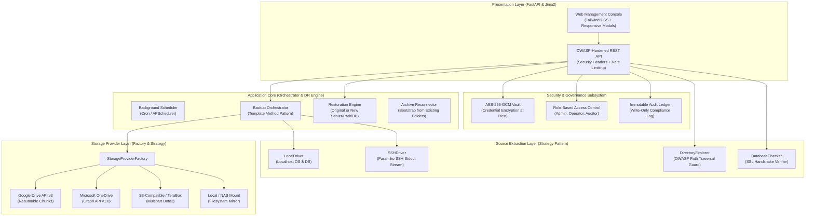

# Enterprise Backup & Disaster Recovery Management Platform

[](file:///g:/projects/star/backup_service)
[](file:///g:/projects/star/backup_service/security/vault.py)
[](file:///g:/projects/star/backup_service/storage)
[-green.svg)](file:///g:/projects/star/backup_service/tests/test_report.html)
[](file:///g:/projects/star/.github/workflows/ci.yml)

An enterprise-grade, secure Web Application & Management Platform for automated multi-tenant backups, point-in-time disaster recovery, and hybrid multi-cloud synchronization.

Designed in accordance with **SOLID Object-Oriented Principles**, **OWASP Security Standards**, and **GoF System Design Patterns**.

---

## 1. Architectural Highlights & Design Patterns



### Architectural Principles Implemented
- **Single Responsibility Principle (SRP)**: Distinct decoupled modules for Cryptographic Vault, Storage Providers, State Catalog, Directory Browsing, and Restoration.
- **Open/Closed Principle (OCP)**: New cloud storage destinations (e.g. Dropbox, Backblaze) or database engines implement abstract base classes without altering the orchestrator core.
- **Liskov Substitution Principle (LSP)**: Any `StorageProvider` or `SourceDriver` can be swapped transparently at runtime.
- **Interface Segregation Principle (ISP)**: Granular provider interfaces for reading, streaming uploads, directory traversal, and retention pruning.
- **Dependency Inversion Principle (DIP)**: High-level orchestration depends purely on abstract interfaces; concrete providers are instantiated via `StorageProviderFactory`.

### OWASP Top 10 Security Hardening
- **A01: Broken Access Control**: Strict server-side RBAC token verification, object-level tenancy checks, and path traversal guards (`..` and symlink containment).
- **A02: Cryptographic Failures**: All sensitive credentials (database passwords, SSH keys, cloud secrets) are encrypted at rest using **AES-256-GCM** with unique nonces and PBKDF2-HMAC-SHA256 key derivation.
- **A03: Injection Prevention**: Strictly parameterized SQLite queries (`?` bindings), argv-based subprocess execution (never `shell=True` with unescaped input), and parameterized SSH commands.
- **A05: Security Misconfiguration**: Automated security response headers (`X-Frame-Options: DENY`, `X-Content-Type-Options: nosniff`, `Content-Security-Policy`, `Referrer-Policy`).
- **A09: Security Logging & Monitoring**: Write-only immutable audit ledger (`audit_logs`) capturing user ID, IP address, action, resource, outcome, and timestamp.

---

## 2. Remote Cloud Storage Structure (Uniform per Client)

Every client tenant follows the exact same hierarchy across all storage gateways:

```
[Cloud Backup Root] (e.g. STAR_Enterprise_Backups)
└── <client_id>/
    ├── master/
    │   └── files/
    │       └── <source_id>/
    │           └── [Cumulative latest snapshot; files removed from source are PRESERVED]
    │
    └── incremental/
        ├── 2026-11-12/
        │   ├── database/
        │   │   ├── <db1_name>_2026-11-12_100000.sql.gz
        │   │   └── <db2_name>_2026-11-12_100000.sql.gz
        │   ├── files/
        │   │   └── <source_id>/
        │   │       └── [Files added or modified on this specific date]
        │   ├── manifest.txt
        │   └── manifest.json
        │
        ├── 2026-11-11/
        │   └── ...
        └── (Automatically purged when age > 10 days)
```

---

## 3. Quickstart & Web Server Launch

### Step 1: Install Dependencies
```bash
pip install -r backup_service/requirements.txt
```

### Step 2: Start Management Web Console
```bash
python -m backup_service.web.server --port 8080 --host 0.0.0.0
```

Open your browser to: **`http://localhost:8080`**  
Default Superadmin Credentials:
- **Username**: `admin`
- **Password**: `admin@STAR2026!`

---

## 4. Multi-Cloud Storage Setup & Credential Guide

Configure offsite cloud repositories or on-premises storage gateways:

---

### A. Google Drive (API v3)
Used for automated offsite archiving to personal Google Drive or Google Workspace Shared Drives:

#### Option 1: Service Account (Recommended for Unattended Servers & Cron)
1. **Google Cloud Console**: Go to [https://console.cloud.google.com/](https://console.cloud.google.com/) and create a project (e.g. `Enterprise-Backup-System`).
2. **Enable Drive API**: Navigate to **APIs & Services > Library**, search for **Google Drive API**, and click **Enable**.
3. **Create Service Account**: Go to **APIs & Services > Credentials > Create Credentials > Service Account**. Enter a name (e.g. `backup-operator`), click **Create and Continue**, then **Done**.
4. **Generate JSON Key**:
   - Click the created service account email.
   - Go to the **Keys** tab > **Add Key** > **Create new key** > Select **JSON** > Download.
5. **Position Key on Server**:
   - Save the downloaded file to your server (e.g., `./service_account.json` or `/etc/backup_service/service_account.json`).
   - Restrict permissions: `chmod 600 /etc/backup_service/service_account.json`.
6. 🚨 **MANDATORY PERMISSION STEP (Folder Sharing)**:
   - Copy the service account email (e.g. `backup-operator@your-project.iam.gserviceaccount.com`).
   - Open your Google Drive in a web browser ([drive.google.com](https://drive.google.com)).
   - Create a folder named **`STAR_Enterprise_Backups`** (matches the `Root Backup Folder Name`).
   - Right-click folder > **Share** > paste the Service Account email.
   - Set permission to **Editor** > uncheck "Notify people" > click **Share**.
   *(Without this step, Google Drive API will reject uploads with error 404 or 403 because service accounts do not have access to personal Google Drive storage).*

#### Option 2: OAuth2 Client Flow (Desktop / Interactive User)
1. In Google Cloud Console, configure **APIs & Services > OAuth consent screen** (type: External, add scope `.../auth/drive`, add your email under Test Users).
2. Go to **Credentials > Create Credentials > OAuth client ID** (Application type: **Desktop app**).
3. Download JSON and save as `./client_secret.json`.
4. On first backup or test, an interactive browser authorization link generates `./token.json`.

---

### B. Microsoft OneDrive & SharePoint (Microsoft Graph API)
Used for automated replication to Microsoft 365, OneDrive Business, or personal OneDrive accounts:
1. **Azure Portal App Registration**:
   - Go to [Azure Portal](https://portal.azure.com/) or [Microsoft Entra admin center](https://entra.microsoft.com/).
   - Navigate to **Microsoft Entra ID > App registrations > + New registration**.
   - Name: `StarEnterpriseBackup`. Supported account types: *Accounts in any organizational directory and personal Microsoft accounts* (or Single tenant for enterprise).
   - Click **Register**.
2. **Collect Tenant ID and Client ID**:
   - On the App **Overview** screen, copy:
     - **Application (client) ID**: (e.g. `4a2b91c0-xxxx-xxxx-xxxx-xxxxxxxxxxxx`)
     - **Directory (tenant) ID**: (use `common` for personal accounts or tenant UUID for enterprise)
3. **Generate Client Secret (Key)**:
   - In the left sidebar, click **Certificates & secrets > + New client secret**.
   - Description: `backup-secret-key`, Expiration: `24 months`. Click **Add**.
   - ⚠️ **CRITICAL**: Immediately copy the string in the **Value** column before leaving the page.
4. **Grant Graph API Permissions**:
   - Go to **API permissions > + Add a permission > Microsoft Graph**.
   - Choose **Application permissions** (for background server service) or **Delegated permissions**.
   - Add permissions: `Files.ReadWrite.All` and `offline_access`. Click **Add permissions**.
   - Click **Grant admin consent for [Tenant]**.

---

### C. AWS S3 / S3-Compatible & TeraBox Cloud
Used for high-throughput object storage across AWS S3, TeraBox S3, Wasabi, Cloudflare R2, and MinIO:
1. **Create S3 Bucket**:
   - Go to [AWS S3 Console](https://console.aws.amazon.com/s3/) > **Create bucket**.
   - Name: `my-enterprise-backups-star` (globally unique). Keep *Block Public Access* enabled and enable SSE-S3 encryption.
2. **Create IAM User & Access Keys**:
   - Go to [AWS IAM Console](https://console.aws.amazon.com/iam/) > **Users > Create user**.
   - Name: `star-backup-operator`.
   - Permissions: Attach `AmazonS3FullAccess` or granular least-privilege policy (see below).
   - Under **Security credentials > Access keys > Create access key** (Application outside AWS).
   - Copy **Access Key ID** (`AKIA...`) and **Secret Access Key**.
3. **Production Least-Privilege IAM Policy**:
```json
{
  "Version": "2012-10-17",
  "Statement": [
    {
      "Effect": "Allow",
      "Action": ["s3:ListBucket", "s3:GetBucketLocation"],
      "Resource": "arn:aws:s3:::my-enterprise-backups-star"
    },
    {
      "Effect": "Allow",
      "Action": ["s3:PutObject", "s3:GetObject", "s3:DeleteObject", "s3:AbortMultipartUpload"],
      "Resource": "arn:aws:s3:::my-enterprise-backups-star/*"
    }
  ]
}
```
4. **S3 Endpoint URLs**:
   - Standard AWS S3: Leave empty or `https://s3.amazonaws.com`
   - TeraBox S3 Gateway: `https://s3.terabox.com`
   - Wasabi: `https://s3.wasabisys.com`
   - MinIO (Private Network): `http://192.168.1.100:9000`

---

### D. Local Filesystem & Mounted NAS (NFS / SMB)
Zero-cloud-cost on-premises storage targeting local NVMe drives, USB arrays, or company NAS appliances:
1. **Directory Setup & Linux Permissions**:
```bash
# Create directory
sudo mkdir -p /mnt/nas/backups

# Assign ownership to backup daemon user
sudo chown -R starbackup:starbackup /mnt/nas/backups

# Restrict permissions (owner read/write/exec, group read/exec)
sudo chmod -R 750 /mnt/nas/backups
```
2. **Permanent Mount via `/etc/fstab`**:
```fstab
# NFS NAS Mount Example
192.168.1.100:/volume1/backups  /mnt/nas/backups  nfs  defaults,rw,nosuid,hard  0  0

# SMB / Windows Share Mount Example
//192.168.1.100/backups  /mnt/nas/backups  cifs  username=backup_user,password=SecretPass,uid=starbackup,gid=starbackup  0  0
```
3. **Windows Hosts**:
   - Specify absolute drive paths (e.g. `D:/Enterprise_Backups`) or UNC paths (`\\192.168.1.100\backups\star`). Ensure the Windows user running the service has write access.

---

## 5. Key Feature Walkthroughs

### A. Interactive Server Directory Browser
1. In the **Clients & Targets** tab, click **+ Add Folder Source**.
2. Click **Browse Server Directory**.
3. The platform interactively streams directory listings over Localhost or SSH SFTP with folder icons.
4. Click any folder to drill down, or click **Select This Folder** to auto-populate the path with zero typing.

### B. Database Targets with SSL Encryption
1. In **+ Add Database Target**, select engine (`MySQL`, `MariaDB`, `PostgreSQL`).
2. Toggle **Enable Secure SSL/TLS Connection for Database**.
3. Credentials are encrypted at rest with AES-256-GCM before writing to the database.
4. Click **Test DB Connection** to verify TCP reachability and protocol handshake.

### C. Disaster Recovery & Flexible Point-in-Time Restore
1. In the **Disaster Recovery** tab, select any historical snapshot.
2. Select **Restoration Destination**:
   - **Original Location**: Restores directly back to the source server and databases.
   - **New Location**: Select a target recovery server, new file directory (e.g. `/opt/dr_restored`), and new database name (e.g. `star_recovered_db`).
3. Click **Execute Point-in-Time Restoration**. The engine streams compressed SQL dumps and copies files to the new target.

### D. Reconnect Existing Backups to a New Installation
If disaster strikes and you deploy a brand new installation:
1. Navigate to **Disaster Recovery** -> **Attach Existing Cloud Backups**.
2. Select your Storage Gateway (Google Drive, OneDrive, Local, S3/TeraBox).
3. Click **Scan & Reconnect Existing Backups**.
4. The crawler scans the root directory, auto-discovers all client folders, reads historical `manifest.json` files, and immediately reconstitutes the disaster recovery catalog.

### E. Self-Update through GitHub
1. In **System & Auditing**, click **Check GitHub**.
2. The platform queries GitHub for the latest release tag and commit hash.
3. If an update is available, click **Apply Update (Git Pull)** to fast-forward without service interruption.

---

## 5. Automated Test Harness & Test Reports

Run the complete 12-vector test harness:
```bash
python -m backup_service.tests.run_all_tests
```

Generates a standalone, styled HTML report viewable in your browser:
[`backup_service/tests/test_report.html`](file:///g:/projects/star/backup_service/tests/test_report.html).

### Verified Test Vectors (12/12 Passed - 100%):
1. **Catalog**: ACID SQLite State Store & Soft Deletion Tracking
2. **Manifest**: Audit Manifest Formatting & Retained File Notice
3. **Retention**: 10-Day Sliding Window Pruning (Incremental + DB / Master Preserved)
4. **Security**: AES-256-GCM Cryptographic Vault & Tamper Detection
5. **Security**: PBKDF2-HMAC-SHA256 Password Hashing (100,000 Iterations)
6. **Security**: Tamper-Proof Signed Session Tokens
7. **Security**: OWASP Role-Based Access Control (RBAC) Matrix
8. **Explorer**: OWASP Path Traversal (`..`) Prevention
9. **Explorer**: Local Directory Tree Navigation
10. **Storage**: Factory Pattern & Local Provider
11. **Storage**: Unknown Provider Exception Guard
12. **Disaster Recovery**: Archive Reconnection & Point-in-Time Restoration

---

## 6. Production Deployment Options

### Option 1: Linux Server (Systemd Daemon)
Run the automated installation script:
```bash
sudo bash backup_service/deploy/install.sh
```
This creates a dedicated system user (`starbackup`), sets up a virtual environment, installs dependencies, and enables the systemd service and timer.

### Option 2: Docker Container
Build and run the hardened container:
```bash
docker build -t starbackup:latest -f backup_service/deploy/Dockerfile .
docker run -d -p 8080:8080 -v /opt/star_data:/data starbackup:latest
```

### Option 3: Central Orchestrator Managing Remote Servers
Run on localhost or a central management node. Configure remote servers in the UI with SSH credentials (password or private key). Database dumps stream securely over SSH stdout directly into local staging, requiring **zero disk space overhead on the remote server**.
