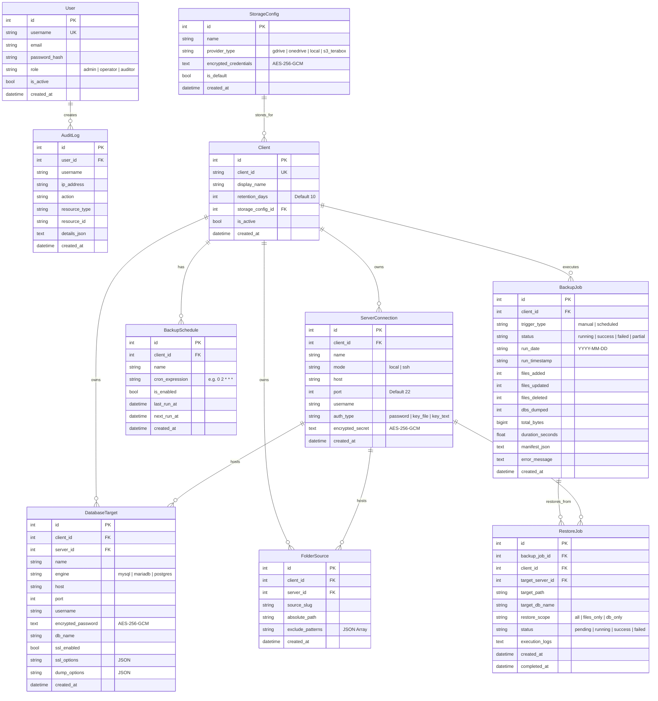

# Data Model: 008-enterprise-backup-recovery-platform

## Entity-Relationship Diagram

---

## Field Constraints & Validation Rules

1. **User.role**: Must strictly be one of `['admin', 'operator', 'auditor']`.
2. **Client.client_id**: Lowercase alphanumeric slug `^[a-z0-9_-]{3,64}$`. Unique across system.
3. **Client.retention_days**: Integer $\ge 1$, default $10$.
4. **Encrypted Fields**: All fields marked `encrypted_*` are ciphertext blocks formatted as `v1:<salt_b64>:<nonce_b64>:<tag_b64>:<ciphertext_b64>`. Decryption happens only in memory upon driver initialization.
5. **DatabaseTarget.engine**: `['mysql', 'mariadb', 'postgres']`.
6. **ServerConnection.mode**: `['local', 'ssh']`. If `ssh`, `host` and `username` are required.
7. **AuditLog**: Write-only ledger. Records cannot be updated or deleted through the application API.
